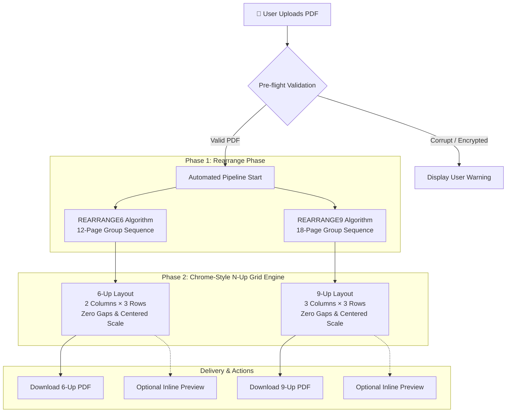

# PDF N-Up Optimizer 📄⚡

> **High-performance, 100% client-side web application that rearranges and packs multi-page PDF documents into Chrome-style 6-up and 9-up print sheets.**

[](https://www.typescriptlang.org/)
[](https://react.dev/)
[](https://vitejs.dev/)
[](https://tailwindcss.com/)
[](LICENSE)
[](docs/N_UP_PDF_IMPLEMENTATION_SECURITY_PLAN.md)

---

## 🌟 Overview

**PDF N-Up Optimizer** transforms standard PDF documents into optimized multi-page handouts, study guides, and booklet-ready sheets. By merging **custom booklet-ordering algorithms** with **Chrome-style N-up grid layouts**, it delivers professional-quality print-ready documents while reducing paper usage by up to **89%**.

Everything runs directly inside your web browser via [`pdf-lib`](https://pdf-lib.js.org/). **Your documents never leave your computer.**

---

## ✨ Key Features

- **Automated Two-Phase Processing Pipeline**:
  1. **Rearrange Phase**: Modifies source page order using specialized booklet algorithms (`REARRANGE6` for 12-page groups, `REARRANGE9` for 18-page groups) with automatic blank padding.
  2. **Chrome-Style N-Up Phase**: Compiles the reordered stream into 6-up (2 columns × 3 rows) and 9-up (3 columns × 3 rows) sheets preserving native vector fidelity and proportional scaling.
- **Magic UI Animated Theme Toggler**:
  - Seamless light and dark mode switching powered by the native **Browser View Transitions API** (`document.startViewTransition`).
  - Expanding circular `clip-path` ripple effect radiating from the toggle button coordinates with zero layout shift.
- **Interactive Drag & Drop Upload Zone**:
  - Drag-and-drop or single-click file picking.
  - Automatic validation for PDF signatures, file size (up to 50 MB), and password encryption detection.
  - Automatic processing triggers immediately upon upload.
- **Instant In-Browser PDF Previews**:
  - By default, generated outputs stay lightweight and neat.
  - Toggle interactive, collapsible in-browser PDF viewers on demand.
- **Zero Server Footprint & Total Privacy**:
  - Processing is 100% client-side with zero external network requests.
  - Operates completely offline once loaded.

---

## 📐 Processing Pipeline Architecture



---

## 🔬 Mathematical & Layout Specifications

### 1. 6 Pages Per Sheet (6-Up)
- **Input Page Grouping**: Chunks of 12 pages.
- **Sequence Mapping**:
  $$\text{Order} = [1, 3, 5, 7, 9, 11, 4, 2, 8, 6, 12, 10]$$
  *(Odd pages mapped to front sheet, even pages arranged for reverse-side alignment).*
- **Grid Structure**: $2 \text{ columns} \times 3 \text{ rows}$.
- **Target Sheet**: Standard A4 Portrait ($595.28 \times 841.89 \text{ pt}$).
- **Cell Dimensions**: Width $\approx 297.64 \text{ pt}$, Height $\approx 280.63 \text{ pt}$.
- **Gaps & Margins**: $0 \text{ pt}$ (borderless Chrome-style print layout).

### 2. 9 Pages Per Sheet (9-Up)
- **Input Page Grouping**: Chunks of 18 pages.
- **Sequence Mapping**:
  $$\text{Front} = [0, 2, 4, 6, 8, 10, 12, 14, 16]$$
  $$\text{Back} = [5, 3, 1, 11, 9, 7, 17, 15, 13]$$
- **Grid Structure**: $3 \text{ columns} \times 3 \text{ rows}$.
- **Target Sheet**: Standard A4 Portrait ($595.28 \times 841.89 \text{ pt}$).
- **Cell Dimensions**: Width $\approx 198.43 \text{ pt}$, Height $\approx 280.63 \text{ pt}$.
- **Gaps & Margins**: $0 \text{ pt}$.

---

## 📁 Repository Structure

```
PDF_REARRANGE/
├── .github/
│   └── workflows/
│       └── deploy.yml            # CI/CD deployment workflow
├── docs/
│   └── N_UP_PDF_IMPLEMENTATION_SECURITY_PLAN.md
├── scripts/
│   └── test-nup.mjs              # Automated Node test suite
├── src/
│   ├── components/
│   │   ├── layout/
│   │   │   ├── Navbar.tsx        # Top navigation with status pills & theme toggle
│   │   │   └── Footer.tsx        # Security & privacy badge footer
│   │   ├── pdf/
│   │   │   ├── UploadZone.tsx    # Accessible drop zone with input handlers
│   │   │   ├── ResultsPanel.tsx  # Download actions & embedded PDF previewer
│   │   │   └── InfoCards.tsx     # Wireframe A4 previews & benefit cards
│   │   ├── ui/
│   │   │   ├── animated-theme-toggler.tsx # Magic UI View Transitions component
│   │   │   ├── badge.tsx         # shadcn Badge component
│   │   │   ├── button.tsx        # shadcn Button component
│   │   │   ├── card.tsx          # shadcn Card component
│   │   │   └── separator.tsx     # shadcn Separator component
│   │   └── theme-provider.tsx    # Theme context & transition coordinator
│   ├── features/
│   │   └── pdf/
│   │       └── PDFNUpPage.tsx    # Main feature orchestrator & reactive state
│   ├── lib/
│   │   └── utils.ts              # ClassName merge utility (clsx + tailwind-merge)
│   ├── App.tsx                   # Layout root wrapper
│   ├── main.tsx                  # React DOM entry point
│   ├── index.css                 # Design tokens & View Transitions styling
│   ├── nUpPdf.ts                 # Core N-Up grid geometry & embedding engine
│   ├── REARRANGE6.tsx            # 12-page group booklet sequencing algorithm
│   └── REARRANGE9.tsx            # 18-page group booklet sequencing algorithm
├── index.html                    # Single-page application template
├── package.json                  # Dependencies & execution scripts
├── tailwind.config.js            # Tailwind theme tokens
├── tsconfig.json                 # Path aliases & compiler options
└── vite.config.ts                # Vite build configuration & chunk splitting
```

---

## 🚀 Getting Started

### Prerequisites
- [Node.js](https://nodejs.org/) v18.0.0 or higher
- [npm](https://www.npmjs.com/) v9.0.0 or higher

### Installation

```bash
# 1. Clone the repository
git clone https://github.com/Virendra-Phirke/N-UP.git
cd N-UP

# 2. Install dependencies
npm install
```

### Development Server

```bash
npm run dev
# The application will launch at http://localhost:3000/
```

### Production Build & Preview

```bash
# Build optimized production bundle
npm run build

# Preview production build locally
npm run preview
```

### Running the Test Suite

```bash
npm test
```
The automated test runner validates:
- [x] Filename sanitization against malicious path characters.
- [x] Output sheet count calculations across arbitrary page lengths.
- [x] Uniform scaling across mixed aspect ratios (portrait, landscape, square).
- [x] Error handling for encrypted, truncated, or corrupt PDF inputs.
- [x] Automatic handling of pre-rotated pages (`/Rotate 90`, `180`, `270`).

---

## 🔒 Security & Privacy Guarantees

- **No Remote Transmission**: PDF files are never uploaded to any backend or cloud server.
- **Client-Side Sandbox**: All manipulation occurs strictly inside the browser sandbox using Web Workers and typed byte arrays.
- **Decryption Safeguard**: Encrypted and password-protected files are rejected up-front to prevent unauthorized processing or data leakage.
- **Memory Safety**: Output blob URLs are automatically revoked upon unmount or file replacement to prevent client memory leaks.

---

## 🌐 Browser Compatibility

| Browser | Minimum Version | View Transitions Theme Effect |
| :--- | :---: | :---: |
| **Google Chrome** | 111+ | Full (`document.startViewTransition`) |
| **Microsoft Edge** | 111+ | Full |
| **Brave / Opera** | Recent | Full |
| **Apple Safari** | 18+ | Full |
| **Mozilla Firefox** | 120+ | Instant theme switch fallback |

---

## 📄 License

This project is open-source and released under the [MIT License](LICENSE).
